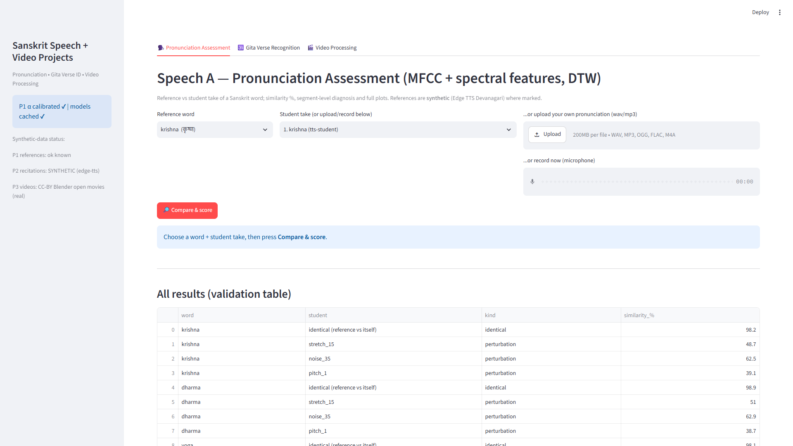
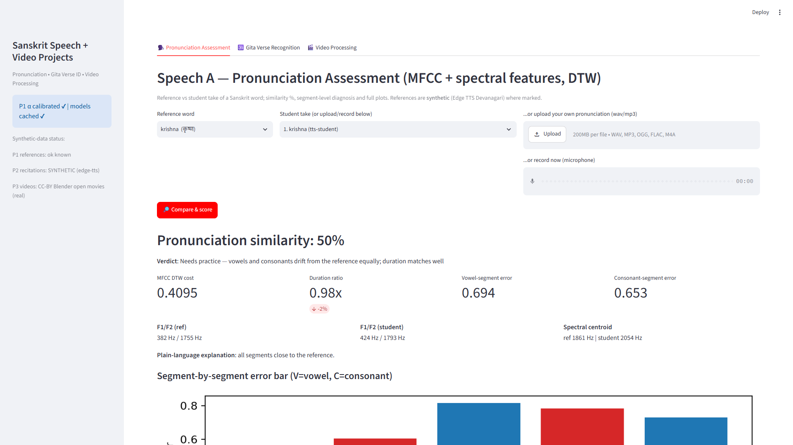
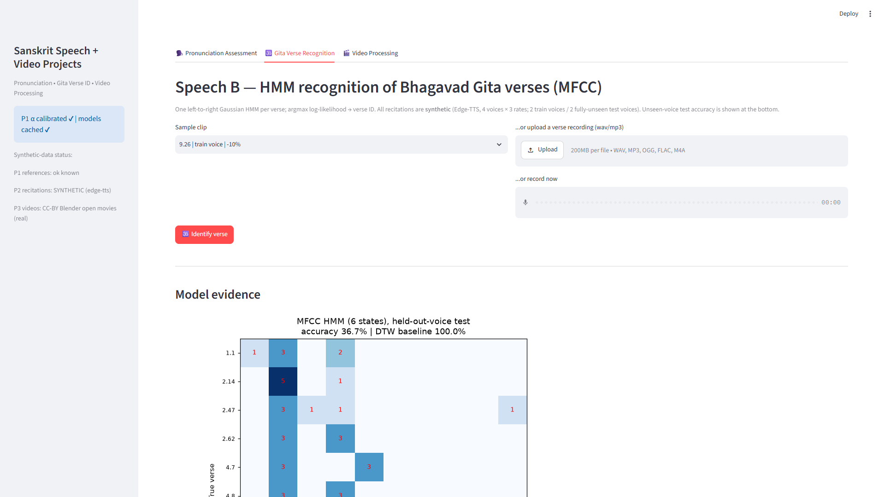
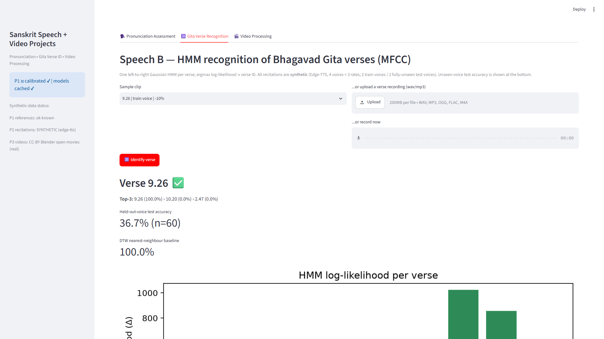
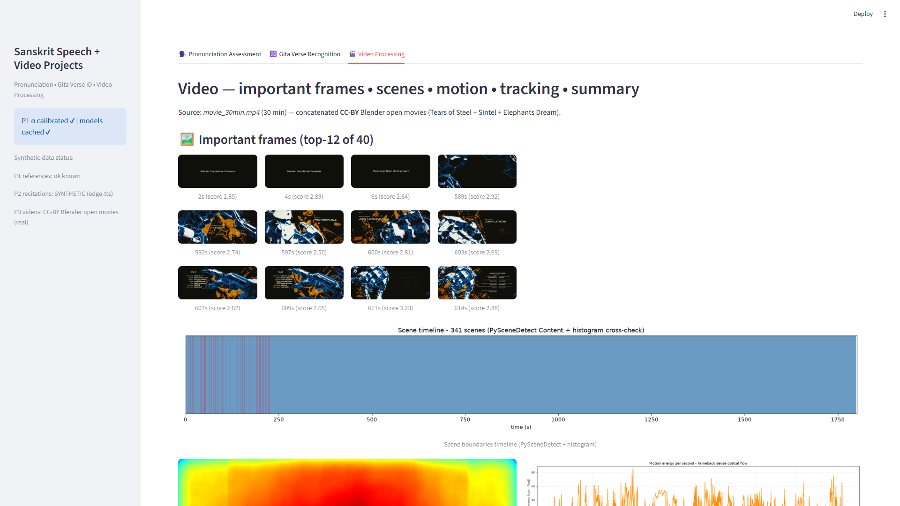
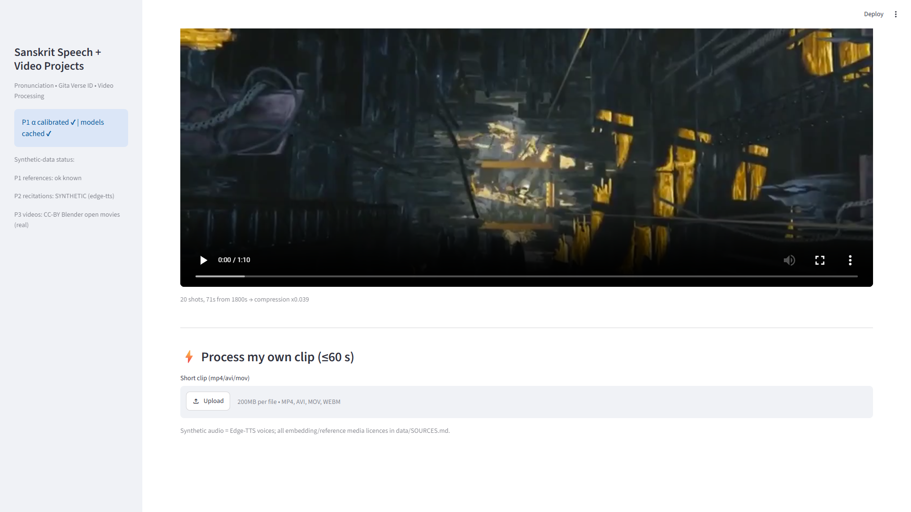

<div align="center">

# Dhvani Yantra 🎧

**Sanskrit pronunciation assessment, Bhagavad-Gita verse recognition, and video intelligence — three projects, one offline Streamlit demo.**


-orange)


</div>

---

## What is this?

| # | Module | What it does |
|---|--------|--------------|
| **P1** | **Pronunciation Assessment** | Records or uploads a spoken Sanskrit word (कृष्ण · धर्म · योग · शान्ति · ॐ) and compares it with a reference through MFCC + spectral features and DTW, returning a **similarity estimate** with vowel/consonant segment diagnosis. |
| **P2** | **Gita Verse Recognition** | One left-to-right Gaussian HMM per verse over MFCCs; a recitation is identified by maximum log-likelihood, with held-out-voice evaluation. |
| **P3** | **Video Processing** | Important frames, scene boundaries, optical-flow motion maps, YOLOv8n + ByteTrack person tracking, and a 60–90 s summary of a 30-minute input. |

Everything runs **offline on CPU** from cached models and bundled data — no API keys, no GPU, no network at demo time.

---

## Demo

<table>
<tr>
<td><br><sub><b>P1</b> — record / upload / pick a bundled take, with a recording-review panel</sub></td>
<td><br><sub><b>P1</b> — similarity estimate, verdict and segment-level diagnosis</sub></td>
</tr>
<tr>
<td><br><sub><b>P2</b> — verse clip selection and upload</sub></td>
<td><br><sub><b>P2</b> — verse ID with top-3 ranking and per-verse likelihoods</sub></td>
</tr>
<tr>
<td><br><sub><b>P3</b> — key frames and scene timeline</sub></td>
<td><br><sub><b>P3</b> — 60–90 s auto-summary player</sub></td>
</tr>
</table>

A recorded walkthrough is available as [`demo_walkthrough.mp4`](demo_walkthrough.mp4); the full screenshot set lives in [`screenshots/`](screenshots/INDEX.md).

---

## Quick start

```bash
git clone https://github.com/AtulTejaswi/Dhvani-Yantra.git
cd Dhvani-Yantra

./run_demo.sh          # Linux / macOS / WSL / Git Bash
run_demo.bat           # Windows
```

The launcher reuses (or creates) the virtual environment, installs only missing
dependencies, rebuilds any missing dataset/model caches, and opens the app at
**http://localhost:8501**.

Manual equivalent:

```bash
pip install -r requirements.txt
streamlit run app.py
```

### Tests

```bash
python -m pytest tests -q        # 31 passed (~6 s)
```

`tests/test_core.py` covers the feature spec, DTW and CMVN; `tests/test_p1_audio.py`
is the regression suite for the recording pipeline — empty/silent/too-short/corrupt/
clipped/quiet input, stereo down-mix, 44.1/48 kHz → 16 kHz resampling, stale-take
handling, and end-to-end score generation.

### Reproduce the reported numbers

```bash
python src/speech_a/p1_eval.py          # P1 calibration + evaluation table (~15 min)
python src/speech_a/p1_speaker_bias.py  # speaker-vs-word bias probe (~1–2 min)
python src/speech_b/p2_train_eval.py    # P2 HMM train + held-out-voice eval (~15–25 min)
python src/video/p3_prepare.py && python src/video/p3_run_all.py   # P3 (~20–40 min)
python tools/capture.py                 # regenerate screenshots + walkthrough
```

---

## P1 — the microphone pipeline

The Pronunciation tab supports three **explicit** input sources — 🎙️ microphone
take, 📁 uploaded file, 📚 bundled sample — and never falls back silently between
them. The recording flow is:

```
browser MediaRecorder ──► bytes (WebM/Opus, MP4/AAC or WAV — sniffed from magic bytes)
        │
        ▼
  decode (soundfile, ffmpeg fallback) ──► stereo→mono ──► resample 16 kHz ──► float32
        │
        ▼
  validate: empty · undecodable · non-finite · too short · silence/clipping · low level
        │            (configurable thresholds, actionable messages — no junk scores)
        ▼
  trim leading/trailing silence (35 dB, 20 ms pad) ──► guarded peak normalisation
        │
        ▼
  review panel: raw playback · duration · peak · RMS · clipping · waveform · retake
        │
        ▼
  MFCC (13+Δ+ΔΔ) + spectral features ──► jitter-ensembled DTW ──► similarity estimate
```

**Design guarantees**

- **Calibration preserved.** Feature extraction (25 ms/10 ms, 512-point FFT),
  the DTW implementation, the distance weights and α = 3.0559 (from
  `cache/p1_alpha.json`) are untouched. Re-processing shifts scores by
  ≤ 0.01 points on the calibrated pairs — asserted by a unit test (≤ 0.5 pts,
  identical pair ≥ 95 %).
- **Quality failures ≠ pronunciation mismatches.** Invalid input produces an
  actionable error instead of a misleading number.
- **Honest scoring.** The output is labelled a *similarity estimate* against a
  **synthetic** reference — acoustic closeness, not validated phonetic accuracy.

### Speaker-bias probe (why the scores are estimates)

Measured with [`src/speech_a/p1_speaker_bias.py`](src/speech_a/p1_speaker_bias.py)
on the bundled corpus (all audio synthetic, details in `results/P1/speaker_bias.json`):

| pair | mean similarity |
|---|---|
| identical (same speaker, same word) | **97.9 %** |
| same word, **different Neural voice** (identical text) | **32.2 %** |
| same word, different voice + romanised spelling | 45.8 % |
| different word (mismatch baseline) | 25.0 % |

Changing *only the speaker* costs more than saying a *different word*
(−7.2 pts margin). Human voices are far further from a Neural-TTS reference than
one Neural voice is from another, so real takes should be expected to score lower
regardless of pronunciation quality. This is a lower bound of the speaker penalty —
not a validation of real-voice accuracy, which requires human recordings the
project does not have.

---

## Repository layout

```
Dhvani-Yantra/
├── app.py                    # unified Streamlit demo (Pronunciation · Gita · Video)
├── run_demo.sh / run_demo.bat
├── requirements.txt          # pinned
├── README.md · DECISIONS.md · report.md · report.pdf · DEMO_SCRIPT.md
├── src/
│   ├── lib_audio.py          # feature spec: 16 kHz, 25/10 ms, 13 MFCC + ΔΔΔ
│   ├── lib_data.py           # TTS + free-media fetchers, ffmpeg wrapper
│   ├── speech_a/             # P1: build_data · core (DTW/α) · eval · p1_audio (input pipeline) · speaker-bias probe
│   ├── speech_b/             # P2: build_data · train_eval (HMM + DTW baseline)
│   └── video/                # P3: prepare · scenes · keyframes · motion · track · summary
├── tests/                    # pytest — feature spec, DTW, CMVN, recording pipeline
├── data/                     # every file + licence + synthetic flags → data/SOURCES.md
├── results/P1, P2, P3        # metrics JSON/CSV + all plots
├── screenshots/              # 1920×1080 captures + INDEX.md
├── report.md / report.docx / report/report.pdf
└── cache/                    # α calibration, HMM pickles, video analysis (resumable)
```

---

## Data, honesty & limitations

- **All speech is synthetic** (Microsoft Edge-TTS) and every asset is flagged in
  the app UI and in [`data/SOURCES.md`](data/SOURCES.md); all video comes from
  CC-BY Blender open movies. There is **no third-party copyrighted media**.
- P2's test set is a synthetic held-out voice — reported accuracy is an
  upper-bound estimate of the real-recording case.
- DTW segment labels are acoustic (voiced/unvoiced), not phonetic alignments;
  the explain-text wording reflects that.
- Microphone captures are decoded with the bundled ffmpeg for WebM/MP4
  containers; plain WAV/MP3/FLAC/OGG decode in-process.
- Detailed assumptions, fallbacks and deviations: [`DECISIONS.md`](DECISIONS.md).

---

<div align="small">

Built as an academic assignment package · [Issues](https://github.com/AtulTejaswi/Dhvani-Yantra/issues) · Media licences in [`data/SOURCES.md`](data/SOURCES.md)

</div>
